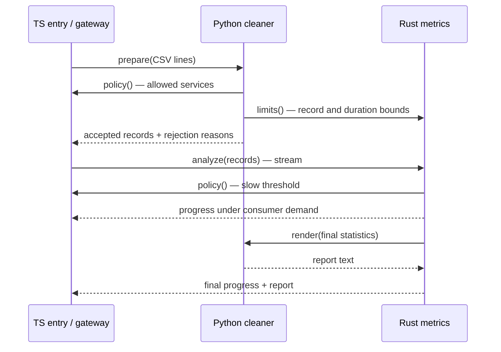

# Polyglot request insights

A working local CLI application: TypeScript accepts CSV, Python validates and
normalizes it, Rust computes streaming request statistics, and Python renders
the final report. Each service also calls its peers through the existing Runtime
SDK. All three runtimes execute as real processes; no language or transport is
mocked.

The application uses the unchanged Runtime v1 kernel from `765db7a` and consumes
the Python SDK delivered in `e3c557dc92d962128961f49e3612f6718d33bf2f`.
This branch includes that dependency commit. Application changes are confined to
this directory and `scripts/polyglot-insights.ts`; the kernel, wire, existing
SDKs, root manifests, and `tools/generate.ts` are unchanged by the application.

## Run

Requires Bun, Node (for TypeScript compilation), Cargo/Rust and Python 3.11+ on
`PATH`. From the repository root:

```sh
bun scripts/polyglot-insights.ts
```

This one command installs the locked JS dependencies, builds the existing TS
SDK/kernel and isolated Rust example, starts the three services, processes the
bundled synthetic fixture, prints the report, and awaits cleanup. First-time
dependency installation may need registry access. No package is published.
The Rust example has its own locked workspace so the root Cargo workspace need
not change. Build steps have a three-minute bound and surface failure log tails.

Expected final report:

```text
10 requests; 2 server errors; 4 slow requests; p95 800 ms; mean 235.0 ms.
```

Four invalid input rows are rejected with line-specific reasons. Progress arrives
after 2, 4, 6, 8 and 10 accepted records. `application_ready` is emitted only after
Runtime status confirms all expected capabilities ready on TCP. Logs and an
`evidence.json` containing results, source/binary hashes, checks and process exit
states are saved under `target/polyglot-insights/<run-id>/`. The final stdout event
links the exact evidence path. Each child log retains a bounded 64 KiB tail.

To process another **synthetic** CSV file:

```sh
bun scripts/polyglot-insights.ts --input /absolute/path/requests.csv
```

No header; each row is `service,status,duration_ms`. Allowed services are `api`,
`web`, and `worker` (case and surrounding spaces are normalized). HTTP status is
100–599 and duration is an integer 0–60000. Invalid rows are reported and removed.
The input is bounded to 256000 bytes, 1000 rows and 256 characters per row. An
empty input or a batch with no valid records returns a typed business error.
Server errors are status >=500; slow requests are duration >=250 ms. p95 uses
the nearest-rank definition over the processed records, including rejected-free
final statistics. Everything stays in memory apart from local diagnostic files.

`PYTHON` may select another Python executable. `LENSO_PYTHON_SDK_ROOT` may select
the `sdk/python` directory in another checkout for integration testing; by
default the SDK in this repository is used. Missing Python fails explicitly.
There is no TS substitute for Python and no claim of a completed Python run
until its capabilities have become ready and its real results are received.

## Actual call graph



All arrows travel through the same real Rust Runtime over loopback TCP. Trace IDs
and parent call IDs are propagated. Generated clients in all languages use the
three JSON contracts in `contracts/`. TS/Python and TS/Rust business functions do
not embed a second wire protocol. Python imports the delivered SDK unchanged.

Rust forwards handler cancellation to nested calls and releases stream work on
early return, abort, deadline or connection loss. Python propagates normal
asyncio task cancellation into nested calls and logs its `finally` cleanup.
The verification suite checks both route retirement and application cleanup,
including cancellation of the nested TS policy callback.

## Verify

```sh
bun scripts/polyglot-insights.ts --verify
bun test examples/polyglot-insights/lifecycle.test.ts
bunx --no-install tsc --noEmit -p examples/polyglot-insights/tsconfig.json
cargo clippy --locked --manifest-path examples/polyglot-insights/rust/Cargo.toml --target-dir target -- -D warnings
```

`--verify` uses the bundled fixture and intentionally terminates only processes
that this invocation started. It verifies:

- The exact numerical result and all six directed language pairs, with trace
  evidence from real application handlers.
- Typed Python/Rust business errors, input validation and six concurrent Python
  calls with distinct correlated results.
- Rust stream emission: zero chunks without demand, one chunk per requested
  credit, and cleanup after an early consumer return.
- Python and Rust nested cancellation and deadlines, with handler release and
  zero remaining Runtime calls.
- Python death during an in-flight call; an explicitly started replacement does
  not receive the old request. A new explicit call succeeds.
- Rust death during a pending stream; the caller receives `connection_lost`.
- Kernel death during an in-flight Python→TS callback; pending work fails and
  Python observes disconnect and exits itself.

Lifecycle tests additionally check graceful zero-exit cleanup, released ports,
concurrent/idempotent close, Python startup errors with log tails, and interruption
during startup without orphan processes. Normal runs do not execute the fault
suite. `--verify` and custom `--input` should be run separately.

Regenerate the application bindings using the existing generators:

```sh
for name in gateway metrics cleaner; do
  bun tools/generate.ts examples/polyglot-insights/contracts/$name.json examples/polyglot-insights/generated $name
  PYTHONPATH=sdk/python/src python3 -m lenso_runtime.generate examples/polyglot-insights/contracts/$name.json examples/polyglot-insights/generated/$name.py $name
done
```

Local results and their exact commands are recorded in [VERIFICATION.md](VERIFICATION.md).

## Boundaries

This application verifies **TypeScript, Rust and Python over loopback TCP**.
Go, stdio and WebSocket are not covered by this application. Python methods here
are unary; Rust provides the application stream. The Python SDK's own streaming
tests are separate evidence, not an application-level claim.

There is no database, paid action, deployment, credential change, external
service, automatic reconnect or implicit retry. Transport/call errors, deadlines
and cancellation **do not imply that side effects were rolled back**. All fault
workloads are synthetic, bounded, in-memory operations. Cancellation remains
cooperative; this example does not promise preemption of blocking Python code
or arbitrary CPU-bound work. Local macOS arm64 is verified; Windows and other
platforms are unverified. This is a working integration example, not a production
network/security certification or a performance benchmark.
